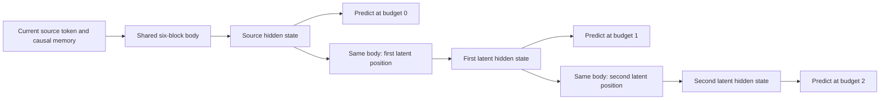

# What the supported-budget experiment can establish

This explanation precedes the experiment's held-out readout. The immutable
[learning protocol](SUPPORTED_LATENT_BUDGET_LEARNING_20261029.md) determines
the comparisons and decisions; this document introduces no new gate.

The model has six unique Transformer blocks and 51,747,328 parameters. Its
latent states are generated from the prefix without vocabulary sampling,
teacher answers or future-token access. The final natural-token loss trains
the shared computation directly.

Each update selects one trained budget for the whole window. It applies uniform
natural-token loss at that budget's final state. This is not a sum of three
exit losses, a learned stopping rule or per-token allocation. Source and latent
positions leave causal keys and values for later positions. The model does not
add a separate direct feedback connection into the next source token's input.

Three different quantities must remain separate:

| Quantity | Meaning in this experiment |
|---|---|
| Physical depth | Six distinct blocks, shared at each processing position |
| Latent budget | Zero, one or two additional generated states before prediction |
| Numerical refinement count | Parallel solver rounds used to approximate the sequential state during training |

Increasing numerical rounds is not test-time thought scaling. The decisive
readout generates states in exact causal order with a cache. Both positive
budgets must also pass TRAIN-only solver consistency before any held-out score.

This distinction follows the parallel-versus-sequential construction studied
in [PonderLM-2](https://arxiv.org/html/2509.23184v4). Our implementation and
short, smaller-model results do not inherit that paper's findings. Similarly,
[Trading Depth for Time](https://arxiv.org/html/2609.21605v2) reports gains
within explicitly trained thought budgets, but uses MoE backbones and additional
direct feedback. Its result is motivation, not a prediction for this model.

A two-over-one improvement alone could reflect damage to the shallow mode.
The independent fixed-one model and zero-exit retention guard address that
alternative. A gain over the strongest ordinary model is another separate
comparison. All four registered development gates are required to advance.

Even if every gate passes, a trained two-pause control is still needed to test
the second generated state's contribution beyond equal-length computation.
Fresh-seed and fresh-source confirmation, transferable reasoning and learned
allocation remain separate requirements. The two evaluation reserves stay
sealed in this experiment.

Finally, the candidate consumes about 4.45 times the strongest ordinary model's
nominal training-matrix work at equal data. Exact inference with two latent
tokens performs three body applications per source token and stores the extra
positions. Prediction gains here would not establish lower training or serving
cost. Complete measured execution costs remain alongside the matrix ledger.
