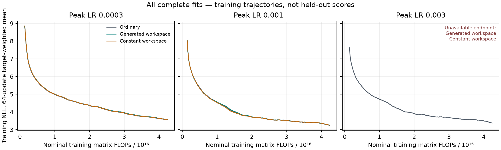

# Sparse persistent workspace: descriptive control completion

7 of nine original learning-rate opportunities completed with mature audits. The original screen remains STOPPED after a non-finite-gradient attempt. This separate completion trains only the three previously unstarted controls and reuses the five audited histories. No failed fit is retried, and no LR, endpoint or original deadline is extended. The original all-nine-complete gate stays UNMET; unavailable fits have no invented NLL. Each family received three independent learning-rate opportunities. The selected checkpoints were rescored in FP64 on all 384 reused DEV sources. This is one paired random-initialization seed, with 60/20/20 web/math/code weighting. Both fresh evaluation reserves remain unscored; terminal alpha spent is zero.

| Selected family | Peak LR | Exact broad NLL ↓ | Web | Math | Code |
|---|---:|---:|---:|---:|---:|
| Ordinary | 0.001 | 3.287681006 | 3.787724963 | 2.959580110 | 2.115650030 |
| Generated workspace | 0.001 | 3.292243358 | 3.793067821 | 2.964857459 | 2.117155866 |
| Constant workspace | 0.001 | 3.292884560 | 3.795751204 | 2.961359972 | 2.115809219 |

Positive gain favors the generated workspace.

| Comparator | Generated gain, nats | Conditional 95% interval | Registered development gate |
|---|---:|---|---|
| Ordinary | -0.004562352 | [-0.008551281, -0.000505369] | UNMET: original screen incomplete |
| Constant workspace | +0.000641203 | [-0.003595801, +0.004989581] | UNMET: original screen incomplete |

Each gate requires a gain of at least 0.01 nats, a positive conditional lower bound, and interior learning-rate optima for all three families. These intervals condition on selected models and reused development sources. They do not measure training-seed uncertainty or constitute confirmation.

**Both original registered gates: UNMET.** No automatic scaling or confirmation follows. Neither outcome establishes learned allocation, transferable reasoning or useful additional inference steps.

## All learning-rate opportunities

These are the common accelerator selection readouts; the selected-model table above uses the independent FP64 readout. No endpoint is omitted.

| Family | Peak LR | Selection NLL ↓ | Selected |
|---|---:|---:|---|
| Ordinary | 0.0003 | 3.598497030 |  |
| Ordinary | 0.001 | 3.287680457 | yes |
| Ordinary | 0.003 | 3.416793097 |  |
| Generated workspace | 0.0003 | 3.611004676 |  |
| Generated workspace | 0.001 | 3.292242801 | yes |
| Constant workspace | 0.0003 | 3.605428221 |  |
| Constant workspace | 0.001 | 3.292883994 | yes |
| Generated workspace | 0.003 | unavailable: numerical failure | no |
| Constant workspace | 0.003 | unavailable: numerical failure | no |

## Resources

| Selected family | Parameters | Natural targets | Nominal training matrix FLOPs | Warm update, s | Worker fit, s |
|---|---:|---:|---:|---:|---:|
| Ordinary | 51,179,008 | 128,810,414 | 42,406,576,492,904,448 | 0.313149 | 839.835 |
| Generated workspace | 51,179,008 | 128,025,288 | 42,392,085,538,013,184 | 0.378193 | 1201.733 |
| Constant workspace | 51,179,008 | 128,025,288 | 42,392,085,538,013,184 | 0.376809 | 1211.241 |

Ordinary receives 1.000341832 times the generated arm's nominal training matrix work. This ledger counts executed matrix rectangles, including the vocabulary projection, with FMA=2 and backward=2× forward. Elementwise work, communication and launch latency are outside it. Worker fit durations include startup, compilation and checkpoint work; warm-update durations exclude startup. These are descriptive cross-run timings, not a hardware-time-matched trial.

All original and completion attempts plus accelerator readout used **41.099033 assigned chip-hours**. Its preceding qualifications used **15.304764 assigned chip-hours**, including both timed-out attempts. Total assigned accelerator cost for these histories is **56.403797 chip-hours**. Host-only audits and readouts are recorded separately. Reserved-instance opportunity cost is not added again to assigned chip-time.

## Numerical checks and scope

Each scored endpoint passed the unchanged independent full-global TRAIN-gradient audit, full model/optimizer/RNG restoration and replica checks. The selected exact readout contains 72 cached/full-prefix checks. All genuine targets are scored once with uniform next-token weighting. Generated and constant slots have identical parameters and matrix work; the constant-input body can still read its causal prefix.

The original position diagnostic is not admitted because the original completion prerequisite failed. Unsupported slot budgets, fresh confirmation and serving performance have not been evaluated.

Machine-readable evidence: [analysis](compare.json), [all selections](select.json), [exact readout](readout.json), [original costs](../learning-v1/execution-costs.json), [remaining-fit costs](fit-execution-costs.json), [readout costs](readout-execution-costs.json), [full report](report.json).
