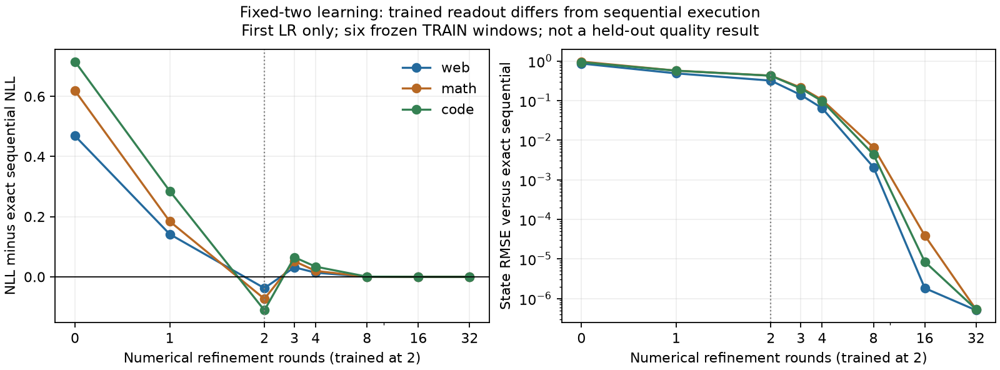

# Learned-state consistency: first two endpoints fail the fixed-two guard

The initialization passes all three domain guards. The first audited latent
endpoint (LR0.0003,128,025,288 targets) fails them. Higher-round states converge
to the independently implemented exact sequential history, but the trained
two-round readout is meaningfully different.

| Domain | Exact sequential NLL minus K2 NLL | KL(p_K2 || p_sequential) |
|---|---:|---:|
| Web |+0.037709|0.055073|
| Mathematics |+0.073237|0.116940|
| Code |+0.111294|0.103735|

These are two frozen TRAIN windows per domain, outside fitting and numerical-
audit ranges. They are not a held-out predictive comparison or an estimate of
general reasoning capability. Both NLL discrepancy and KL exceed the0.01
eligibility tolerances. K16/K32 KL is below1.1e-9 in every domain: eventual
convergence does not rescue a low-round approximation.

The short-prefix cached/recomputed reference checks pass. No weights change
during this40.48-second CPU diagnostic. The full active tuning comparison is
unchanged and no predictive scores have yet been released. The other two latent
endpoints remain pending. No automatic fixed-K2 extension or cheap sequential
inference claim is admitted. A separately qualified mixed-round comparison is
the next specific hypothesis; it is not assumed to repair this mismatch.

[Frozen protocol](../../../docs/INTERLEAVED_CONVERGENCE_DIAGNOSTIC_20261029.md)
and [first-endpoint aggregates](latent-lr0.json).

## Second audited endpoint, LR0.001

The identical diagnostic takes40.21 CPU seconds and again fails the guard in
all domains. Exact-sequential minus K2 NLL is+0.002844 on web,+0.040639 on math,
and+0.091553 on code. Forward KL is0.058263,0.077923 and0.085006 respectively.
The smaller aggregate web loss shift does not imply close prediction agreement.
K16/K32 KL remains below1.2e-7. The third endpoint is pending; no learning-rate
selection or quality promotion follows from these TRAIN-only diagnostics.
[Second-endpoint aggregates](latent-lr1.json).
