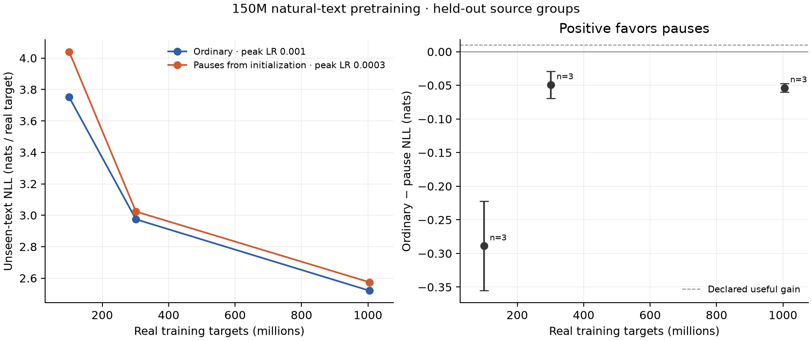

# Natural-text learning curve — complete

**Fixed pauses did not improve unseen-text prediction in this 150M / 1B-target pilot.** Across three paired seeds, ordinary NLL is **2.519907** and early-pause NLL is **2.573797**. Pause gain (ordinary minus pause) is **-0.053890 nats**, with paired-seed 95% interval **[-0.060287, -0.047493]**. The predeclared 0.01-nat useful gain is ruled out at this exposure under the fixed tuning procedure. Every seed and domain favors ordinary.

The complete campaign used **3.687 node-hours** on the existing instance, including tuning and the measured preparation/qualification/run window. All 16 chips trained each fit. All 49 supervised phases passed. TEST remains sealed and unchanged. The idle development container is stopped; data, full states and caches remain on this instance outside Git.

## Learning curves

| Real targets per run | Ordinary mean NLL | Early-pause mean NLL | Gain (positive favors pauses) | Paired-seed 95% interval |
| ---: | ---: | ---: | ---: | --- |
| 100,488,104 | 3.751589 | 4.040532 | -0.288943 | [-0.355418, -0.222468] |
| 301,465,908 | 2.974138 | 3.023412 | -0.049274 | [-0.069240, -0.029307] |
| 1,004,887,590 | 2.519907 | 2.573797 | -0.053890 | [-0.060287, -0.047493] |

The 100M and 300M points are descriptive stable-trunk measurements. Both 1B endpoints complete their decay; the 1B comparison is primary. Final seed gains are −0.051011 / −0.055975 / −0.054684 for seeds 23 / 47 / 71. Pauses largely catch up between 100M and 300M, then retain a deficit at the measured 1B endpoint. Both arms substantially improve unseen-text NLL as training proceeds.

Each model scores the same **614 isolated documents / 777,348 real targets / 360 source groups**. The aggregate weights domain token NLLs 60/20/20. [CSV](learning-curve.csv), [SVG](learning-curve.svg), [aggregate records](summary.json), and [domain curves](domain-curves.svg) contain the complete observations.

| Domain at 1B | Ordinary mean NLL | Early-pause mean NLL | Gain |
| --- | ---: | ---: | ---: |
| Web | 3.000095 | 3.060654 | -0.060559 |
| Math | 2.262162 | 2.307594 | -0.045432 |
| Code | 1.337085 | 1.379425 | -0.042340 |

The separate source-group bootstrap interval for the mean fitted-model gain is [-0.055962, -0.051948], using 2,000 joint group draws. This is conditional on the fitted models and is separate from the primary initialization-seed interval. Domain analyses are exploratory. See [source-group uncertainty](source-group-uncertainty.json).

## Controlled comparison

The [protocol](../../docs/LEARNING_CURVE_PROTOCOL.md), [specification](specification.json), [corpus manifest](corpus-manifest.json), and [LR choices](selected-lrs.json) were frozen before curve evaluation. Compare two randomly initialized 150,436,608-parameter Llama-style/TorchTitan models with a 32k tokenizer, tied input/output weights, and identical initial weights within each seed. No teacher, RL or generated research examples. The tokenizer is the only pretrained asset.

Both arms consume exactly 1,004,887,590 real targets from one frozen natural web/math/code order (data seed 23), with no wrapping or discarded source tails. Use context 1024, local batch 2, accumulation 2, 64 ranks, BF16 autocast, FP32 masters/AdamW moments, global clipping 1 and token-based WSD. Main initialization seeds are 23/47/71. Every continuation restores full state and validates CPU/native loss and gradients before updates.

Early adds 16 fixed computation inputs per 128 input positions from update one. They carry no prediction labels; the next real token after a pause block is predicted from its final pause. Causal right-tail padding takes expanded length 1152 to 1536 for the qualified native path. It follows all scored positions and passes CPU output/full-gradient invariance tests. All padded work is counted. ID 0 also occurs in 44 natural code source tokens; those remain real targets in both arms, as recorded in the [token-ID audit](source-token-id-audit.json).

Sources and tokenizer revisions are pinned. Source groups are disjoint across TRAIN, tuning DEV, curve DEV and sealed TEST, with global exact deduplication and a disclosed approximate lexical near-duplicate screen. Training packs documents with causal cross-document attention inside each window; evaluation isolates documents. [Data rules](../../docs/DATA.md) disclose upstream model-assisted selection and remaining provenance/deduplication limits.

Each arm independently swept 3e-4 / 1e-3 / 3e-3 on the same first 100M targets and tuning cohort, using seed 11 and a completed short decay. Selected peaks were **1e-3 ordinary** and **3e-4 pause**, then fixed across main seeds. [All six tuning scores](tuning.json) are retained. This compares variants under that bounded tuning procedure; it does not establish globally optimal LRs at every exposure.

## Compute and actual cost

The 100-warm-update qualification measured 855,336 real targets/sec ordinary and 695,948 with padded pauses. Across all main phases, measured warm throughput is **834,056 ordinary / 709,346 pause targets/sec**, including cadence checkpoints. Actual worker/node times include compilation, numerical checks, saves and inference.

The qualified pause path costs **1.562×** the ordinary dense training and full-window forward matmul estimate. Count the complete LM head and all 1536 positions, including right padding. These are dense full-square estimates, not hardware counters. The curves are token-matched; fully annealed matched-FLOP endpoints remain a separate comparison.

| Measured worker time | Hours |
| --- | ---: |
| Main training phases | 2.697 |
| Main held-out inference | 0.315 |
| LR tuning training + inference | 0.474 |
| Padding qualification | 0.043 |
| Inclusive measured node window | 3.687 |

Preparation took 296.98 s and overlaps that node window. Assigned accelerator time is 50.432 chip-hours; the full-node opportunity window is reported separately in the [ledger](resource-ledger.json). Main optimizer training totals 8.443e18 estimated matmul FLOPs; tuning adds 0.844e18. The [cost summary](cost-summary.json) additionally accounts for qualification, CPU/native numerical probes and every inference window (1,091 per curve evaluation; 280 per tuning evaluation), including partial windows. No run has missing FLOP accounting. The predeclared budget was 4.8–7.2 node-hours with an eight-hour cap.

## Correctness and scope

Twenty-nine CPU tests pass. The [complete protocol audit](protocol-audit.json) verifies all 18 curve records, paired initialization, exact exposures, immutable data/protocol hashes, identical training/model/loss/evaluation source, selected LRs, final LR floors, full optimizer recovery, replica equality and clean worker closures. All 49 supervised phases pass with no compiler-error or OOM rejection in this campaign. Maximum CPU/native probe differences are 0.000465 training NLL and 0.001593 evaluation NLL; maximum full-gradient relative L2 is 0.012894. Sampled reserves stayed above 733.65 GiB host available memory and 35.54 GiB filesystem free space.

This is approximately 6.68 real targets per parameter. The negative result applies to this fixed-pause mechanism, exposure, data/context policy and LR selection procedure. The seed interval measures initialization variation conditional on one corpus/order; it is not a convergence, pure introduction-timing, latent-content or autonomous-thought result. Longer exposure and additional mechanism controls remain open.

Full 100M/300M continuation states remain for every seed, and all six annealed endpoints remain local. The [seed-23 stable pair](stable-branches.json) additionally preserves both models at 904,398,582 targets before decay; their hashes remain unchanged after endpoint completion. [Reproduction instructions](../../docs/REPRODUCE_CURVE.md) describe the launch and analysis. Earlier [qualification](../qualification_20261022/REPORT.md), [performance work and failures](../performance_20261022/REPORT.md), original 1.7B evidence and the archived predecessor remain preserved. [Local OSS observations](../../docs/OSS_NOTES.md) were documented without an upstream submission.
