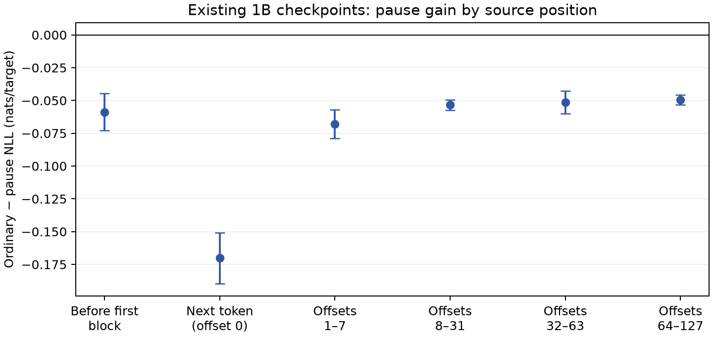

# Existing pause checkpoints: the loss is not hiding a local benefit

At the completed 1B endpoint, every prospectively fixed position bin favors
ordinary prediction. The first real token after a pause block has the largest
deficit. Predictions farther from a block also lose, as do positions before
the first pause in a window. This does not motivate another placement search.

| Position in the original window | Ordinary minus pause NLL | 95% paired-seed interval |
| --- | ---: | ---: |
| Before the first block | -0.05873 | [-0.07285, -0.04461] |
| First target after a block | -0.17017 | [-0.18961, -0.15073] |
| Offsets 1–7 | -0.06783 | [-0.07871, -0.05694] |
| Offsets 8–31 | -0.05344 | [-0.05737, -0.04951] |
| Offsets 32–63 | -0.05142 | [-0.06018, -0.04265] |
| Offsets 64–127 | -0.04940 | [-0.05316, -0.04565] |

These are exploratory, non-simultaneous intervals across the three paired
initialization seeds, conditional on the existing corpus/order. They do not
replace the original negative primary endpoint. The bins were fixed before
their losses were read: one-based original target index j, pre-first j < 128,
then j mod 128. Windows reset at 1024 original target positions. Domain
weights are conditioned on each bin under the original 60/20/20 mixture.

All six checkpoints score the same 614 curve DEV documents / 777,348 real
targets using CPU BF16 matmuls and FP32 normalized CE. Per-domain weighted
bin contributions reconstruct the overall gain exactly within floating-point
reduction tolerance: -0.05389875 nats, versus -0.05388984 in the original native
readout. No new TEST scoring, fitting, checkpoint selection, generated data
or accelerator inference occurs.

The first-after-block deficit is a conditional loss on a small share of
targets; it must not be multiplied by the entire corpus. The JSON records
each bin's actual mixture mass and contribution. The broader deficit remains.
The comparison uses different trained weights. In particular, pre-first-block
loss is evidence about the trained models, not a same-weight inference deletion
effect. These scores do not isolate a single causal reason for the pause loss.

[All aggregates and reconstruction checks](summary.json) ·
[Analysis source](../../scripts/analyze_pause_locality.py) ·
[Original completed study](../learning_curve_20261022/REPORT.md).
