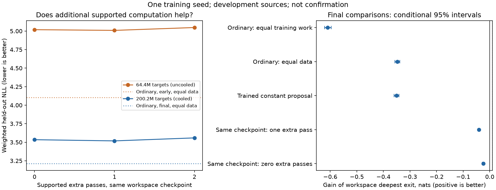

# Probability replay: completed development screen

**The sampled-depth recipe fails all three registered screening gates.** One
extra pass improves the same checkpoint by0.016107nats,but a second extra pass
worsens it by0.040410. Its best exit still loses0.307025nats to the equal-data
ordinary model. The registered deepest exit loses0.347436 at equal data and
0.609401 at equal nominal training matrix work. Every broad domain favors
ordinary. No scaling of this sampled schedule is admitted.

The first replay does not improve the134 natural arithmetic conclusions
(point gain−0.002890,conditional95% interval[−0.029744,+0.019954]). A large
permutation effect is sensitivity to corrupted inputs,not a reasoning result.
All results below are retained;no favorable exit replaces the registered primary.

All four fits, final cooldowns, mature numerical audits and registered evaluation are complete. One random initialization and one common preregistered learning rate; this is not an independently tuned conventional frontier or confirmation.

| Predictor | 60/20/20 NLL | Web | Math | Code |
|---|---:|---:|---:|---:|
| Workspace, zero replay | 3.534179 | 4.038749 | 3.184338 | 2.370311 |
| Workspace, one replay | 3.518072 | 4.020251 | 3.171657 | 2.357950 |
| Workspace, two replays | 3.558482 | 4.052951 | 3.220598 | 2.412961 |
| Ordinary, equal data | 3.211047 | 3.715310 | 2.879815 | 2.029490 |
| Ordinary, equal work | 2.949082 | 3.431622 | 2.649376 | 1.801165 |
| Uniform proposal, equal data | 3.207743 | 3.712267 | 2.878234 | 2.023679 |

Positive paired gains below favor the deepest workspace exit. Intervals reflect evaluation-source variation conditional on these trained weights, not uncertainty across training runs.

| Comparison | Gain, nats | Conditional 95% interval |
|---|---:|---|
| Ordinary: equal training work | -0.609401 | [-0.621617, -0.596686] |
| Ordinary: equal data | -0.347436 | [-0.356654, -0.338498] |
| Trained constant proposal | -0.350740 | [-0.359584, -0.341547] |
| Same checkpoint: one extra pass | -0.040410 | [-0.043501, -0.037388] |
| Same checkpoint: zero extra passes | -0.024303 | [-0.028726, -0.019937] |

The practical screening threshold is0.01nats with a positive conditional lower bound. These decisions do not establish reasoning, autonomous allocation, training-seed robustness or serving efficiency.

Workspace/equal-data/uniform arms each use200,190,896 real targets;ordinary-work uses446,570,790. All final endpoints independently cool to0.1peak learning rate. Earlier64.4M checkpoints are uncooled descriptive points. All320 protected source groups remain unscored.

The deepest workspace readout costs3.4604× ordinary forward matrix work;the sampled training average is2.2302×. These are dense-matrix estimates,not cached-decoding or latency measurements. The uniform proposal is cheaper and does not execute a proposal body.

Full dependency results, all domain signs, the proposal-content intervention, and every registered contrast remain in[analysis.json](analysis.json). Only9code-name cases fit the frozen context;those are not a code-reasoning benchmark. A corruption effect alone is not proof of content-based reasoning.

The original complete workspace fit is reused unchanged after correcting an OrderedDict/dict representation mismatch in the CPU restoration hash. Both checkpoint digests reproduce exactly using the original Native serializer. No numerical tolerance changed. Original stopped-controller costs remain in[the original ledger](../screen-v1/execution-costs.json);The three ordinary/control fits and failed first evaluation remain in[the first recovery ledger](../screen-recovery-v1/execution-costs.json). The zero-update precision diagnosis is in[its ledger](../../probability_workspace_20261029/readout-precision-v1/execution-costs.json);this final evaluation/analysis is separate in[execution-costs.json](execution-costs.json). The independent evaluation reference uses FP64 after two FP64 paths established that FP32 reference error exceeded2e-4 on one permuted batch. Native scores and the2e-4 threshold are unchanged.

No automatic larger fit,router or confirmation is admitted by this screen.
