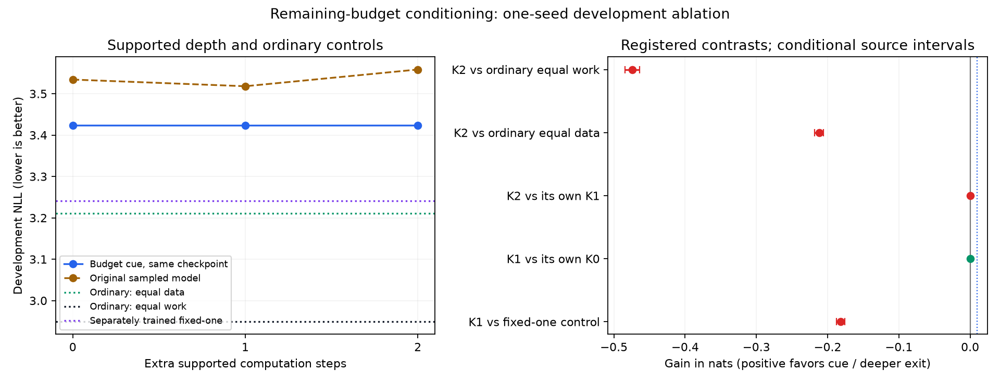

# Remaining-budget cue: completed developmental test

**Budget cues improve the failed sampled model but do not produce useful iteration.**
The same trained checkpoint scores3.423109/3.423031/3.423106 at0/1/2 extra steps.
Both incremental intervals overlap zero;all registered gates fail. The deepest
exit loses0.212059nats to equal-data ordinary and0.474025 to equal-matrix-work
ordinary. Every broad domain favors those controls. This closes this particular
cue ablation;it is not a universal negative for latent computation.

The added TRAIN-only diagnostics sharpen the interpretation. The generated
proposal's centered RMS is only4.0–5.9% of its total RMS across the checked
positions,versus89.0% for separately trained fixed-one and98.6% for the original
sampled model. Its entropy rises to7.34–7.36nats and mean top-one probability is
about0.026. Full-gradient cosine across supported depths is0.978–0.995,not an
opposing-gradient pattern at this endpoint. These observations are consistent
with the cue learning almost constant additional input,not productive iterative
work. Eight TRAIN windows are descriptive evidence,not a causal proof or a new
held-out finding. Permutation causes an11.17-nat loss increase despite the flat
useful-depth curve,illustrating why corruption alone cannot establish thinking.
[TRAIN diagnostic registration](train-diagnostic-plan.json) ·
[Gradient geometry](train-depth-gradients.json) ·
[Proposal statistics](train-proposal-states.json).

The first identical fit completed all1530updates but lost its final state to
checkpoint-copy OOM;its4.949728 assigned chip-hours remain charged. The repaired
same-seed fit uses5.196212 assigned chip-hours and evaluation1.004994,for11.150934
including the lost fit (qualification costs are additional and remain separate).
Four-rank bounded capture passes exact full-state replay;the recovery midpoint
and final checkpoints survive. All64 final replicas agree and all0/1/2 mature
CPU audits pass before scoring. No numerical/resource criterion was relaxed.
[Preserved failed history](../budget-cue-screen-v1/failure-summary.json) ·
[Exact capture qualification](../budget-cue-capture-replay-v1/report.json) ·
[Independent midpoint check](midpoint-check.json).

| Predictor | Weighted development NLL ↓ |
| --- | ---: |
| Cue model, zero extra steps | 3.423109 |
| Cue model, one extra step | 3.423031 |
| Cue model, two extra steps | 3.423106 |
| Separately trained fixed-one | 3.241172 |
| Original sampled model, one extra step | 3.518072 |
| Ordinary, equal data | 3.211047 |
| Ordinary, equal matrix work | 2.949082 |
| Constant proposal | 3.207743 |

Positive gain below favors the cue model or the deeper supported exit.

| Contrast | Gain | Conditional95% source-group interval |
| --- | ---: | --- |
| K2 vs ordinary equal work | -0.474025 | [-0.484078, -0.463558] |
| K2 vs ordinary equal data | -0.212059 | [-0.218287, -0.205687] |
| K2 vs its own K1 | -0.000075 | [-0.000176, +0.000037] |
| K1 vs its own K0 | +0.000078 | [-0.000036, +0.000200] |
| K1 vs fixed-one control | -0.181859 | [-0.187694, -0.175948] |

One new fit from random initialization:1530updates,200,190,896 natural targets,
62,801,408parameters (1024 new cues),unchanged sampled0/1/2 schedule and nominal
matrix-work budget. All three exits are supported. Every endpoint completes
cooldown and independent mature gradients/full-state restoration before scoring.
The old control checkpoints and byte-pinned readouts are reused,not new replication.
The broad384-source-group panel has been repeatedly inspected;intervals condition
on these trained weights and do not include training-seed or model-selection uncertainty.
All320 protected confirmation source groups remain sealed.

The matrix ledger excludes elementwise/optimizer work in every arm;cue additions
are not counted as matrices. Runtime and compilation costs remain separate.
A supplied remaining budget is not autonomous allocation. Permuted proposal
values are an OOD intervention,not sufficient evidence of reasoning. The natural
dependency cases and every domain are reported in the complete analysis.

[Frozen design](../../../docs/BUDGET_CONDITIONED_SCREEN_20261029.md) ·
[Registration](plan.json) · [All scores and contrasts](analysis.json) ·
[Audits and execution](report.json) · [Costs](execution-costs.json).
