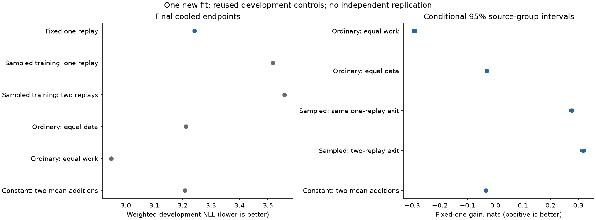

# Fixed one-replay optimization diagnostic

**Fixed-depth training recovers most of the optimization deficit but does not
beat ordinary training.** It improves over the sampled model at the same
one-replay exit by0.276900nats,at exactly equal exposure and matrix work. It still
loses0.030125nats to equal-data ordinary and0.292091 to matched-work ordinary;
all broad domains favor the ordinary controls. The fixed-versus-sampled gate
passes;both ordinary-control gates fail. This is not a thinking or efficiency win.

On the134 natural arithmetic conclusions,the equal-data point gain is+0.031241,
with a conditional95% interval[−0.021080,+0.080576]:inconclusive. At matched work
it loses0.106889nats. Code-name predictions also favor ordinary. These retained
secondary results do not replace the broad primary or admit a larger fit.

One new random-initialization fit is compared with the unchanged audited controls. The candidate and sampled-depth model have exactly the same200,190,896 real targets and190,988,262,121,144,320 nominal training matrix FLOPs. All final endpoints are cooled.

| Model | 60/20/20 NLL | Web | Math | Code |
|---|---:|---:|---:|---:|
| Fixed one replay | 3.241172 | 3.748044 | 2.906886 | 2.054842 |
| Sampled training: one replay | 3.518072 | 4.020251 | 3.171657 | 2.357950 |
| Sampled training: two replays | 3.558482 | 4.052951 | 3.220598 | 2.412961 |
| Ordinary: equal data | 3.211047 | 3.715310 | 2.879815 | 2.029490 |
| Ordinary: equal work | 2.949082 | 3.431622 | 2.649376 | 1.801165 |
| Constant: two mean additions | 3.207743 | 3.712267 | 2.878234 | 2.023679 |

| Comparator | Fixed-one gain | Conditional 95% interval |
|---|---:|---|
| Ordinary: equal work | -0.292091 | [-0.299613, -0.284274] |
| Ordinary: equal data | -0.030125 | [-0.034809, -0.025735] |
| Sampled: same one-replay exit | +0.276900 | [+0.269648, +0.283938] |
| Sampled: two-replay exit | +0.317310 | [+0.308750, +0.326023] |
| Constant: two mean additions | -0.033429 | [-0.038061, -0.029094] |

Only the fixed model’s one-replay exit is trained and supported. It cannot establish a within-checkpoint scaling curve. Source-group intervals condition on the trained weights;one seed and reused development sources do not establish training-seed robustness or confirmation.

The old constant control adds the mean embedding twice,not once,and is only a descriptive comparator. The semantic permutation preserves work/entropy but introduces distribution shift;its effect alone cannot establish reasoning. All arithmetic,code-name and exploratory intermediate-target results remain in[analysis.json](analysis.json). The nine code-name cases are not a multi-step reasoning benchmark.

Repeated control readouts agree within0nats under the unchanged2e-4 criterion. Independent CPU readout references are FP64;the Native predictor and fitted weights are unchanged. All320 protected source groups remain sealed.

Inference requires2.2302× ordinary forward matrix work. That is a matrix-operation count,not measured cached decoding or a latency claim. Ordinary-work receives446,570,790 real targets. This screen uses one common preregistered LR,not an independently tuned conventional frontier.

New execution costs are in[execution-costs.json](execution-costs.json). Reused controls,failed attempts and numerical recovery retain their original ledgers in[the parent comparison](../../probability_workspace_20261028/evaluation-recovery-v2/REPORT.md). Reuse does not create a free new replication.

No automatic larger run,router or confirmation follows this result.
