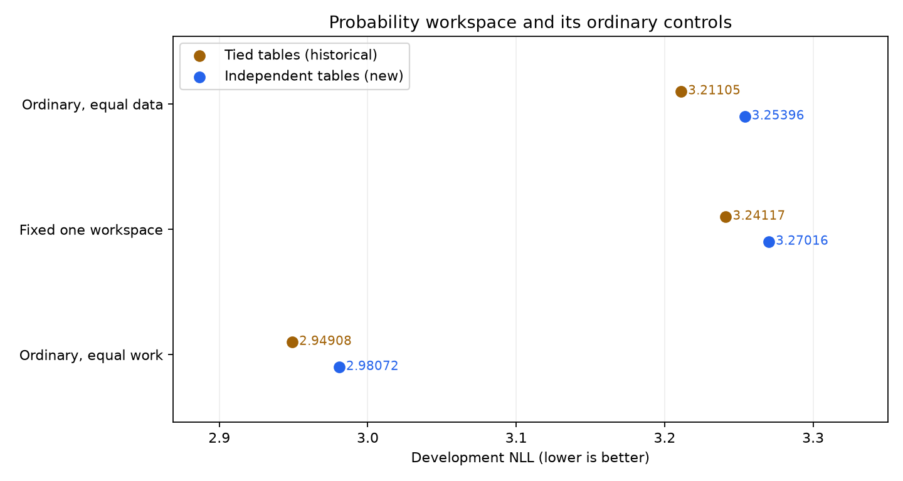

# Independent prediction/value tables: controlled learning screen

The registered screen is negative. The workspace loses0.016197nats to its new
equal-data ordinary control(conditional95%interval[−0.020543,−0.011597])and
0.289434to its new equal-work control([−0.297575,−0.281058]). Both gates fail;
web,math and code each favor ordinary training. This closes this untying screen
at200Mworkspace targets without a scaling or efficiency claim.

Untying makes both the workspace and its ordinary controls **worse** than their
historical tied counterparts at this endpoint. The positive0.013928 interaction
means that the ordinary equal-data model deteriorates more;it is not an absolute
workspace improvement. Parameter counts also change across these generations.
A first-math-token point estimate is not promoted when its interval spans zero
and the full-answer/broad comparisons are unfavorable.

| Model | Tied tables,62.8M | Independent tables,79.18M |
| --- | ---: | ---: |
| Ordinary, equal data | 3.211047 | 3.253960 |
| Fixed one workspace | 3.241172 | 3.270157 |
| Ordinary, equal work | 2.949082 | 2.980723 |

Positive gains below favor the workspace or the untying intervention.

| Contrast | Gain | Conditional95% source-group interval |
| --- | ---: | --- |
| Workspace vs new equal-data ordinary | -0.016197 | [-0.020543, -0.011597] |
| Workspace vs new equal-work ordinary | -0.289434 | [-0.297575, -0.281058] |
| Workspace improvement from untying | -0.028985 | [-0.034058, -0.023728] |
| Ordinary equal-data improvement from untying | -0.042913 | [-0.047587, -0.038346] |
| Change in workspace-minus-ordinary advantage, equal data | +0.013928 | [+0.008036, +0.019883] |
| Change in workspace-minus-ordinary advantage, equal work | +0.002657 | [-0.003669, +0.009280] |

Three new fits share the same79,184,384parameters,initialization,source order and
uniform NTP objective. Fixed-one and ordinary equal-data see200,190,896 real
targets;ordinary equal-work sees446,570,790. All endpoints complete cooldown.
Only the one-replay exit of the workspace model is trained and supported.
Old tied scores are reused byte-identically. They are historical controls,
not new seed replication. Untying adds16,384,000parameters to both new models.
The cross-generation interaction includes that intervention;it is not a
fixed-total-parameter capacity estimate. A relative recovery is insufficient
without the absolute ordinary-control comparisons.

All independent mature gradients,full-state/replica checks and FP64 readout
gates precede quality scoring. One common preregistered LR is a screening
recipe,not the independently tuned conventional frontier. These intervals
condition on one trained seed and a repeatedly inspected development panel.
All domains and authentic dependency targets remain in the full analysis.
The320 protected confirmation groups remain sealed.

There is no supported within-checkpoint iteration curve or learned allocation.
Semantic permutation is an OOD intervention,not reasoning evidence by itself.
Matrix work includes vocabulary projections but excludes elementwise,optimizer
and communication work;assigned chip-time is reported separately. No cached
decoding-speed claim is made. No automatic larger fit or confirmation follows.

[Frozen protocol](../../../docs/UNTIED_PROBABILITY_SCREEN_20261029.md) ·
[All scores](analysis.json) · [Audits](report.json) · [Execution costs](execution-costs.json).

The three fresh fits and evaluation use17.038476assigned chip-hours in total,
with qualification reported separately. The retained workspace/equal-data/
equal-work paths use4.513214/3.922757/7.817220chip-hours. Those paths are matched
on the specified matrix ledger,not hardware time;no runtime-efficiency claim
is supported by the negative quality comparisons.

[Recorded TRAIN curves](training-curves.json) show an early optimization lag
that narrows without reversing by200Mtargets. This is not a future crossover
forecast. [Proposal statistics](train-proposal-statistics.json) show variable
untied intermediate vectors;variation and permutation damage do not establish
useful content. All diagnostic inputs are TRAIN,with no protected-source reads.

The separately preregistered structural readout uses these same checkpoints on
141new source-separated development pairs. It will retain this broad negative
and cannot replace it with a favorable narrow slice. No further fit is admitted
by that diagnostic.
