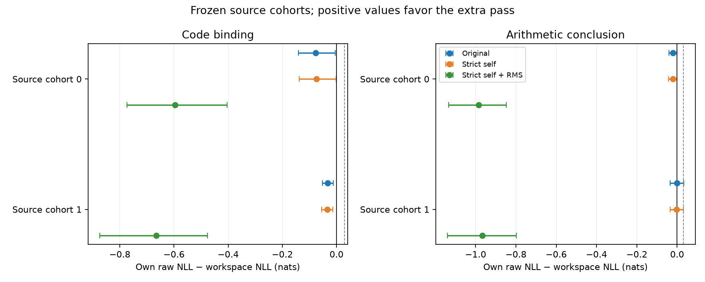

# Recoverable dependencies: context use versus workspace use

**The original workspace fails both primary mechanism gates.** Ordinary prediction reliably uses the supplied code bindings and arithmetic work, while the saved latent model’s extra pass harms both code cohorts and provides no reliable gain on arithmetic. The strict-self control changes little. Input RMS matching makes both families substantially worse. No architecture promotion or additional fit follows.

This is a zero-update development diagnostic of the saved one-step workspace, not a new training or efficiency experiment. All 340 authentic cases and source-group cohorts were frozen before any model panel score. Four exact saved 1.485B models receive the same original reader and two predeclared mechanism controls. No answer-aware selection, new prompts or extra latent depth.

Positive context gain means ordinary prediction benefits from the supplied earlier information. Positive workspace utility means the additional pass improves that same latent model’s answer prediction. Intervals resample source groups conditional on the saved models; they do not measure training-seed uncertainty.

| Family / cohort | Cases / groups | Ordinary context gain | Original workspace utility | Strict-self utility | Strict-self + RMS utility |
| --- | ---: | ---: | ---: | ---: | ---: |
| Code binding / 0 | 36 / 15 | +1.691222 [+1.077215, +2.343946] | -0.077012 [-0.141187, -0.003972] | -0.074806 [-0.138160, -0.002340] | -0.595843 [-0.773626, -0.404499] |
| Code binding / 1 | 60 / 16 | +1.127852 [+0.522391, +1.814080] | -0.032821 [-0.052566, -0.012605] | -0.034324 [-0.054464, -0.013792] | -0.665135 [-0.873692, -0.476878] |
| Arithmetic conclusion / 0 | 57 / 50 | +3.857799 [+3.490794, +4.240482] | -0.020920 [-0.040322, +0.000009] | -0.021543 [-0.041595, +0.000007] | -0.984900 [-1.133950, -0.847470] |
| Arithmetic conclusion / 1 | 77 / 64 | +3.845397 [+3.391707, +4.315798] | -0.001756 [-0.034084, +0.032052] | -0.001862 [-0.034108, +0.031469] | -0.967827 [-1.139185, -0.798613] |
| Arithmetic intermediate (exploratory) / 0 | 42 / 38 | +2.234052 [+1.559417, +2.977494] | +0.021896 [-0.025901, +0.074765] | +0.026634 [-0.022401, +0.081499] | -0.484923 [-0.707088, -0.243748] |
| Arithmetic intermediate (exploratory) / 1 | 68 / 57 | +2.797223 [+2.162862, +3.475326] | -0.000177 [-0.044527, +0.046864] | +0.001956 [-0.043557, +0.048945] | -0.715256 [-0.980865, -0.460493] |

Whole-answer teacher-forced NLL, pooled by real target count within each family, lower is better. Families are not combined into a new broad-text primary metric.

| Family | C0 raw | Ordinary raw | Latent raw | Latent original | Latent strict | Latent strict + RMS | Trained constant original |
| --- | ---: | ---: | ---: | ---: | ---: | ---: | ---: |
| Code binding | 0.590349 | 0.623126 | 0.642252 | 0.694250 | 0.694143 | 1.277317 | 0.730013 |
| Arithmetic conclusion | 1.319440 | 1.281983 | 1.237818 | 1.247963 | 1.248296 | 2.213119 | 1.347097 |
| Arithmetic intermediate (exploratory) | 3.157265 | 2.880878 | 2.961205 | 2.952522 | 2.949343 | 3.584014 | 3.013190 |

There is an important arithmetic distinction: the latent-trained model’s **raw** conclusion score (1.237818) is better than ordinary continuation (1.281983). Adding its workspace worsens that same model to 1.247963. The favorable cross-model arithmetic point estimate therefore does not demonstrate useful inference-time computation; even disabling the workspace preserves—and improves—that score. The registered workspace-versus-ordinary intervals span zero in both cohorts.

The exploratory intermediate-step gain is +0.021896 in one cohort and −0.000177 in the other, with both intervals spanning zero. It is not a replicated computational benefit. On code, even C0 has better pooled raw NLL than the continued models, so broad continuation improvement should not be mistaken for retention on every task.

The original promotion criterion requires adequate coverage in both cohorts, ordinary context gain at least 0.1 nats with positive lower interval, and own workspace gain at least 0.03 nats with positive lower interval. Strict and RMS interventions remain exploratory and cannot rescue the failed original quality/compute claim.

| Family | Original gate | Strict control gate (exploratory) | Strict + RMS gate (exploratory) |
| --- | --- | --- | --- |
| Code binding | FAIL | FAIL | FAIL |
| Arithmetic conclusion | FAIL | FAIL | FAIL |

The code task is a lexical dependency, not a demonstration of multistep reasoning; nearby uses can remain after the defining binding is removed. Arithmetic conclusions follow original human-written work; the short ablation removes almost all of that context. The intermediate family is exploratory because source-authored rewrites need not be uniquely determined. Long code prefixes also exceed the160-position continuation-training regime. These limits prevent a universal reasoning claim.

Two fixed C0 numerical examples showed final normalized feedback RMS 20–51 times the corresponding token-embedding RMS. The original cache also includes both original and new self KV at the same position. These observations motivated the frozen controls; neither establishes the cause of quality loss. The intervention results reject them as simple inference-only repairs of these checkpoints. They do not test training an input adapter or the controls from scratch. Strict embedding replay reproduces ordinary outputs and all gradients on CPU fixtures.

Execution: two Native attempts stopped before any scientific panel scores at the unchanged .001 maximum-logit/.0002 real-target-NLL gate. A separately labeled numerical diagnosis did not waive that gate. The CPU fallback passed all 12 independent full-size HF dense2D reference checks at those same tolerances, then evaluated the complete frozen panel. CPU execution removes only future padding and independent unused queries;25 focused tests, including real-output equivalence, pass. All four model parameter versions stay unchanged.

All final model/AdamW/RNG states and source inputs remain private. No new fit, fresh confirmation, learned allocation, inference speedup or random-initialization claim follows. The previous broad continuation and readout negatives remain unchanged. Across the two cohorts, training reduces the original reader’s raw-to-workspace distribution KL (code about0.030–0.041 at C0 to0.018–0.031;conclusions about0.033 to0.015). Yet own predictive utility remains negative. This is consistent with learning to limit a harmful perturbation;it is not proof of an internal algorithm or a causal account of optimization.

The current evidence localizes the failure to the tested feedback operation: available information is usable by ordinary prediction, but this learned second-pass state does not reliably improve it. It does not establish that NTP cannot reward computation, a universal model-size floor, or impossibility of another latent mechanism.

[Complete costs](complete-costs.json) · [Frozen protocol](../../docs/RECOVERABLE_DEPENDENCY_DIAGNOSTIC_20261028.md) · [Full analysis](cpu-panel/analysis.json) · [CPU execution](cpu-panel/report.json) · [Numerical gate](cpu-panel/cpu-forward-gate.json) · [Original Native stop](inference-v1/report.json) · [Recovery stop](inference-v2/report.json)
