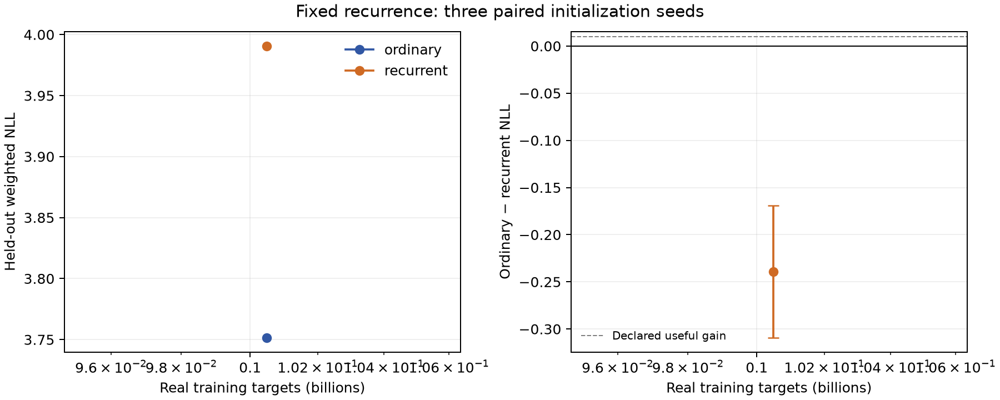

# Fixed recurrence learning curve — running

The three-seed 1B primary comparison is in progress. At the first stable-trunk
readout, **100,488,104 real targets**, ordinary mean NLL is **3.75159** and
two-pass recurrent mean NLL is **3.99059**. Ordinary-minus-recurrent gain is
**-0.23900 [-0.30916, -0.16884]** across the three paired initialization seeds.
These are descriptive stable checkpoints, not the declared annealed endpoint.
The final practical-gain decision is pending. TEST remains sealed.

Both paths have 150,436,608 parameters and identical paired initial weights,
source targets/order, tokenizer, global batch and optimizer recipe. Ordinary
controls are reused from the completed qualified study, disclosed explicitly.
Actual CPU outputs and full gradients prove single-pass equivalence. The new
two-pass core has 36 block applications versus 20 ordinary blocks. There is no
teacher, generated research corpus, RL, textual thought or learned halting.

Independent 100M-target LR selection chose 3e-4 for recurrence from
3e-4/1e-3/3e-3 (tuning NLL 4.07541/4.23321/4.85068). The ordinary reference
already used the same bounded selection budget and chose 1e-3. Selection was
frozen before these curve scores. The failed earlier sandwich-normalization
screen is preserved separately; it never launched a 1B fit.

The primary endpoint is 1,004,887,590 targets with complete final decay.
A useful 0.01-nat gain needs a positive paired-seed lower bound above 0.01;
an upper bound below that threshold rules out that size of gain at this
exposure. The independently annealed FLOP control reads recurrence at
593,774,218 targets against ordinary at 1B. These questions stay separate.

[Machine-readable progress](summary.json) · [Per-seed CSV](learning-curve.csv) ·
[Frozen protocol](../../docs/PRELN_RECURRENT_PROTOCOL.md) ·
[Analysis source](../../scripts/analyze_preln_learning.py).
