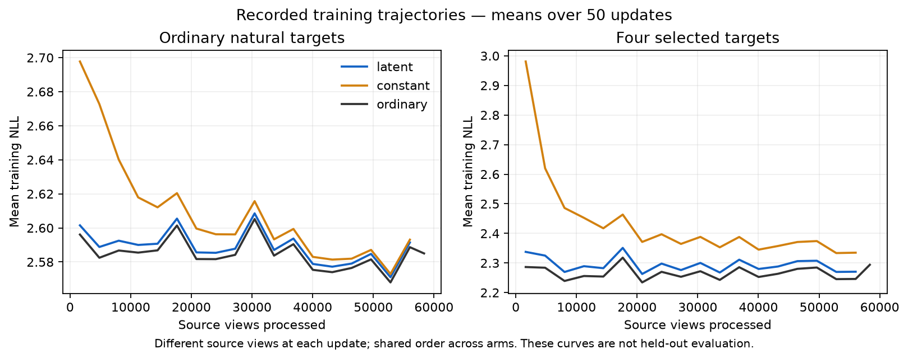

# Sparse differentiable workspace: first discovery result

The frozen three-arm comparison completes and is negative. All three saved endpoints pass independent HF full179-parameter mature-gradient audits,with no fallback. Generated continuous states outperform the trained constant-query control,but do not improve absolute held-out prediction or beat ordinary continuation.

| Predictor | Full32 deployed-policy NLL | Raw32 without workspace | Four selected targets NLL |
|---|---:|---:|---:|
| c0 | 2.282111 | 2.282111 | 2.260540 |
| ordinary | 2.297200 | 2.297200 | 2.264840 |
| latent | 2.305394 | 2.304263 | 2.280496 |
| constant | 2.321481 | 2.315124 | 2.337609 |

C0 is shown without a workspace;its untrained workspace readout is a separate diagnostic in the receipt. The latent arm loses0.008194nats to the same-emphasis ordinary control;conditional source-group95% interval[0.004628,0.012043] for its excess loss. Its workspace also hurts its own selected-position predictions by0.009046nats;that utility interval includes zero. The initial workspace harm was0.058730nats:adaptation reduces harm,but does not establish useful work.

Latent beats the trained constant-query control by0.057113nats on selected positions and0.016086 on the full policy. The large same-work constant-input corruption effect is distribution shifting and does not prove reasoning. Neither arm achieves the preregistered advancement pattern. No larger fit,router,confirmation or random-initialization claim is admitted by this result.

There are448 authentic TUNE source views across116 groups,weighted60/20/20 web/math/code;all32 continuation labels and four fixed opportunities are unchanged across arms. Row aggregation independently reproduces every aggregate exactly. The evaluator receipt's scope string saying“320”is stale text;its coverage field and checked448 private rows establish the actual panel size. Intervals condition on this one seed and reused groups,not training-seed uncertainty. Upstream stage-one pretraining contamination cannot be ruled out.

## Resource accounting

Latent900 and constant900 share57600 source views;ordinary923 has59072 to match nominal matrix work within0.052% rounding. All optimize.5 mean159 raw CE+.5 mean4 selected CE. This heavily reweights four arbitrary targets;it is not uniform next-token prediction. All start at the same C0 weights and fresh AdamW at1e-5. This is a short constant-rate discovery,not converged independently tuned training.

Warm update times:latent1.0728s,constant1.0880s,ordinary0.7891s. Whole Native phases including compile/checkpointing:1356.43/1368.56/1100.69seconds. Latent therefore uses about23.2% more whole assigned phase time than ordinary despite nominal matrix matching. Qualification,CPU audits,evaluation and prior failures remain separately charged. Serving latency and cached decoding were not measured. Four of32 continuation positions receive extra computation;the training2.5% matrix overhead is not a serving-overhead estimate.

Full model/AdamW/RNG checkpoints and authentic audit inputs are retained. Independently checked derivative scratch is retired under the frozen policy;its checksums and zero-update recomputation inputs remain. No parameters,source data,optimizer history or inference outputs are silently corrected.

## Objective diagnostic and next question

Every new trained arm worsens raw continuation loss from C0. On the identical original320 views,the earlier plain-NTP931 checkpoint scores2.256017,versus2.291367 for the new target-emphasized ordinary923 checkpoint. C0 rowwise readout parity is within9.54e-7. The older control has eight more updates and slightly more nominal work,so this is descriptive evidence,not an exact objective-only causal ablation. It nevertheless argues against allocating more tokens to the current emphasized recipe.

The next bounded CPU investigation removes the arbitrary target reweighting:each authentic next token receives one ordinary prediction loss,with randomly selected positions using a differentiable workspace. Independent per-position workspace queries would also allow a position to be added/removed without changing other positions' attention context. That is a new prospective mechanism/learning test,not an extension or reinterpretation of this failed comparison;Native gates and a new frozen budget precede any fit.

The curves average50 updates of changing TRAIN views and do not replace held-out evaluation.
