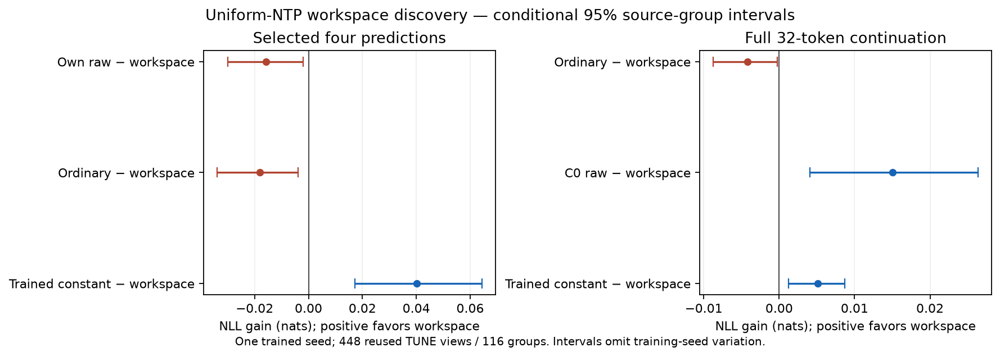

# Uniform-NTP continuous workspace discovery

Status: **DEVELOPMENT_POINT_TARGETS_NOT_PASSED**. Lower NLL is better. One stage-one1.485B pretrained base, one trained seed,448 reused TUNE views /116 source groups, fixed60/20/20 weighting. No confirmation data read.

| Predictor | Total updates | Full32 deployed NLL | Selected4 NLL | Own raw32 NLL |
| --- | ---: | ---: | ---: | ---: |
| Starting checkpoint (no workspace) | 0 | 2.282111261 | 2.260540163 | 2.282111261 |
| Uniform ordinary NTP | 940 | 2.262856181 | 2.237867786 | 2.262856181 |
| Generated continuous workspace | 800 | 2.267064897 | 2.256006383 | 2.265101427 |
| Trained constant-input workspace | 800 | 2.272188967 | 2.296231258 | 2.265132233 |

Uniform weighting restores improvement over C0 in every newly trained arm. It does **not** produce useful workspace computation: latent still loses0.004209nats to ordinary and harms its own selected predictions by0.015708. The generated state beats the trained constant-input control but fails both registered practical targets. This recipe is not promoted to a larger fit.

Positive contrasts favor the generated workspace. Intervals resample source groups conditional on these particular trained models; they omit training-seed uncertainty.

| Contrast | Gain, nats | Conditional95% interval |
| --- | ---: | --- |
| Ordinary minus workspace, full32 | -0.004208716 | [-0.008750023, -0.000251957] |
| Own raw minus workspace, selected4 | -0.015707725 | [-0.029963317, -0.002041621] |
| Trained constant minus workspace, selected4 | +0.040224876 | [+0.017137935, +0.064379542] |
| C0 raw minus workspace, full32 | +0.015046364 | [+0.004093886, +0.026381197] |
| Ordinary minus workspace, first target | -0.010698027 | [-0.040284085, +0.017563497] |

Every159 authentic next-token label appears once with equal weight. At32 randomly sampled eligible positions, a one-step workspace prediction replaces the ordinary prediction. Each query reads causal prefix KV and its own latent key only. Fixed four inference opportunities are supported by that independent mask. No extra parameters,teacher,policy gradient,EMA,synthetic source data or arbitrary selected-target bonus. The constant arm uses the same graph and TRAIN schedule with a trainable existing constant embedding as query input.

The previous emphasized pilot remains negative. This new experiment changes weighting, query density and attention dependencies together; differences do not identify their separate causal effects. C0 with-workspace and ordinary with-workspace readouts are unsupported diagnostics, not their deployed scores. Raw32 and selected4 remain distinct endpoints.

| Arm | Source views | Label exposures | Nominal matrix operations | Retained-path assigned chip-hours |
| --- | ---: | ---: | ---: | ---: |
| latent | 51,200 | 8,140,800 | 95,333,241,585,664,000 | 7.561302 |
| constant | 51,200 | 8,140,800 | 95,333,241,585,664,000 | 5.741174 |
| ordinary | 60,160 | 9,565,440 | 95,286,115,057,008,640 | 6.595988 |

Workspace/ordinary nominal per-view ratio is1.175581131. Ordinary rounding is-0.04943%. Nominal matching is not hardware-time matching. All101 retained latent prefix updates and931 ordinary prefix updates count,including their complete original execution paths. Only699/800/9 new updates run. There is no checkpoint cooldown or optimizer reset. Full restore validates every716 model/AdamW tensor and RNG; latent-prefix gradient replay is exactly zero error.

All three final models pass independent full-size HF dense2D mature all179-gradient audits before the first quality score. Maximum named relative errors: latent 0.002737%, constant 0.002221%, ordinary 0.002442%. No fallback; unchanged2% limit. Disabled-workspace CPU outputs,all gradients and AdamW steps match ordinary exactly. A separate legacy-packing test also matches the reused ordinary path exactly.

Full final model/AdamW/RNG states and authentic audit inputs remain private. Exact audited derivative gradients, superseded temporary latent101 backup and cold derivative references are retired under the frozen policy, with hashes and source receipts retained. This is retirement, not lossless archival. The original ordinary931 scientific endpoint remains.

This is a short constant-rate development continuation, not independently tuned convergence. Reported work is incremental from common C0: the public stage-one foundation and shared30-step reader calibration precede every arm and are not reproduced or charged as arm-specific work. It is not a whole-pretraining compute claim. Upstream stage-one exposure of evaluation sources cannot be excluded. No evidence of learned stopping, token allocation, transferable reasoning or learning from random initialization follows. A positive result would first require fresh validation and mechanism controls; a negative result does not close every latent-workspace design.

[Frozen design](../../docs/SPLICED_WORKSPACE_DISCOVERY_20261028.md) · [Analysis](analysis.json) · [Domain scores](domain-scores.json) · [Complete costs](complete-costs.json) · [Decision](decision.json)
