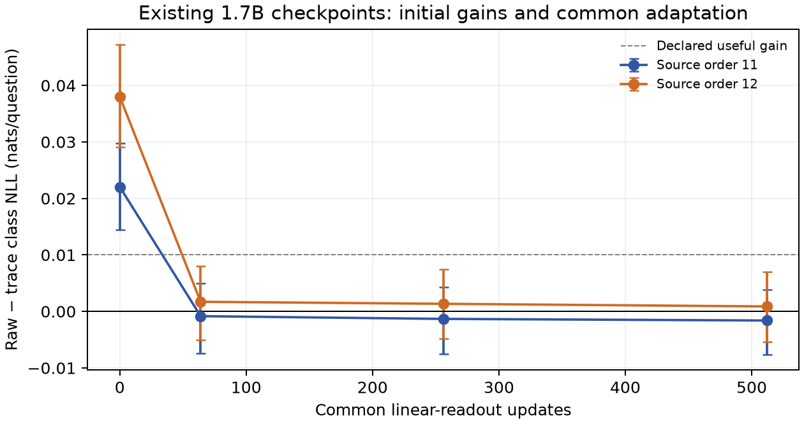

# Existing 1.7B checkpoints: initial gains disappear under a common readout

Trace checkpoints improve the initial four-label exam readout over their matched
raw controls. After the same frozen linear-readout adaptation, that NLL advantage
disappears. The declared 0.01-nat benefit is ruled out for this particular probe
in both source orders; smaller benefits and full-backbone adaptation remain open.

| Source order | Initial raw-minus-trace NLL | After 512 common updates |
| --- | ---: | ---: |
| 11 | +0.02204 [0.01449, 0.02981] | -0.00161 [-0.00761, 0.00389] |
| 12 | +0.03801 [0.02909, 0.04725] | +0.00088 [-0.00535, 0.00703] |

Positive means trace is better. These are nats per four-choice question,
with equal science/reading task weights, not ordinary source-token NLL.
The fixed primary readout is update 512. Initial and intermediate snapshots
are secondary, non-simultaneous intervals; they do not replace that criterion.

The initial advantage is real within this declared readout, but all continued
training checkpoints have worse class NLL than the untouched base. After
adaptation, mean task NLL is 0.53690 for B0; raw 0.58141/0.57930; trace
0.58303/0.57842; mixed-source references 0.58005/0.58251. Accuracy rankings
are not identical: final mean task accuracies are B0 78.63%, raw
77.43%/77.54%, trace 77.86%/77.71%, and mixed 77.75%/78.94%.
The machine-readable report retains every task, snapshot and adaptation seed.

This result is consistent with an advantage that a cheap common readout can
remove; it does not identify calibration or representation change as the
cause. It does not establish absence of transfer under other training recipes.

## Frozen design

Use all four matched raw/trace terminal models, both mixed-source practical
references and untouched Qwen3-1.7B-Base. Original model hashes are checked.
The backbone stays frozen. A zero-initialized 8,196-parameter linear residual
readout learns over its final hidden state, added to original A/B/C/D logits.
The common LR, 0.003, is selected only on B0's TRAIN-only inner groups, then
frozen before any trained checkpoint readout. Every model receives the same
512 AdamW updates, batch 64 and three paired sampling seeds per task.

Human-authored ARC-Challenge TRAIN/validation contributes 1,116/295 eligible
questions; RACE-High contributes 256/128 hash-selected passages with one
question each. Four-option prompts fit 512 tokens without truncation.
No questions, distractors or reasoning traces are generated. No official TEST
is accessed. Adaptation/evaluation source groups are disjoint. Presence in the
mature foundation model's historical pretraining corpus is unknown.

Intervals resample 423 paired source groups, carrying adaptation-seed scores
together, with 2,000 draws. They condition on the original fixed checkpoints.
Two original source orders and three readout seeds are not independent
foundation-model replications. The small RACE subset is not a full benchmark
leaderboard evaluation. No original backbone optimizer trajectory is resumed.

## Numerical and resource checks

The first BF16 padded-batch attempt failed before any trained checkpoint was
scored (feature difference 0.283, answer-logit difference 0.060). Switching to
FP32 reduced the rehearsal differences to 0.000061/0.000012. All seven models
pass the tighter singleton/batched extraction check. The failed attempt is
retained. No scientific criterion or examples changed.

An independent two-thread replay reproduces all stored mean NLLs to
5.96e-8, including every learning-curve snapshot. The complete FP32 extraction
and probe takes 3,663.5 seconds with 16 CPU threads and **zero accelerator
calls**, alongside the new 150M campaign. The forward ledger counts all
padding and qualification calls. One original field mislabeled qualification
examples as singleton calls; the original receipt and explicit accounting
correction are both retained, with no change to scores.

[Complete original readout](readout.json) · [Replay and all curves](replay-and-curves.json) ·
[Data manifest](data-manifest.json) · [Forward accounting](accounting-correction.json) ·
[Frozen protocol](../../docs/TRANSFER_PROBE_PROTOCOL.md) ·
[Original matched training study](https://github.com/dario-fumarola/useful-thoughts-trainium/blob/main/validation/scaffold_learning_complete_20261022/REPORT.md).
